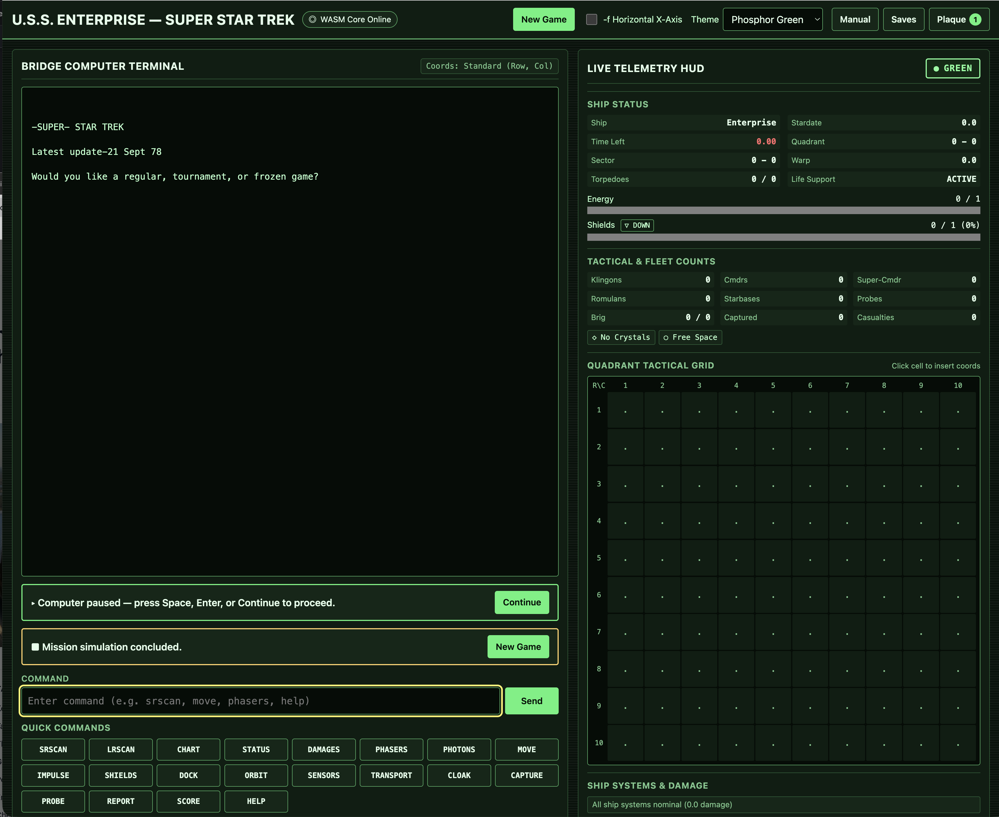
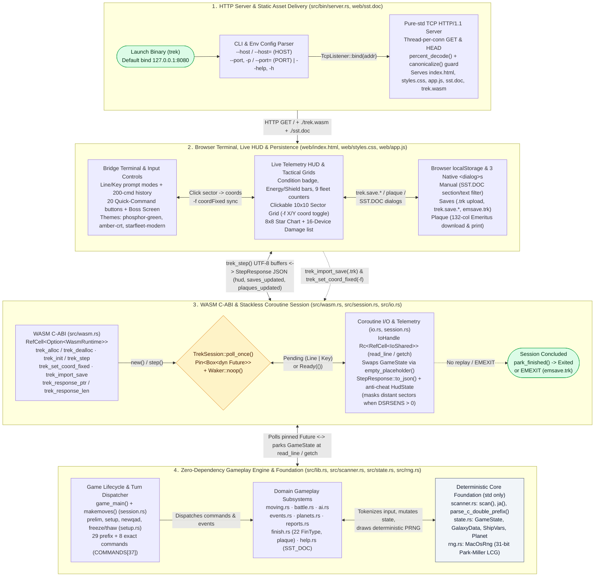

# Trek — Super Star Trek (Rust + WebAssembly)



**Trek** is a zero-dependency Rust and WebAssembly port of Tom Almy's *Super Star Trek for Mac OS* (`https://almy.us/sst.html`), featuring an interactive browser terminal, live Bridge Telemetry HUD, and an embedded pure-`std` HTTP server.

## Overview & Attribution

This project converts the classic ANSI C codebase of *Super Star Trek for Mac OS* (preserved in [`c_src/`](c_src/)) into safe, modular Rust and exposes it to the browser via WebAssembly:

- **Source Template**: Tom Almy's *Super Star Trek for Mac OS* (`SCORE`, `CAPTURE`, and `CLOAKING` options enabled).
- **Zero External Crates**: Both the `trek` library (`cdylib` + `rlib`) and the `trek` HTTP server binary compile using only the Rust standard library (`std`).

## Architecture Highlights

- **Zero-Dependency Rust Game Engine ([`src/`](src/))**: Faithful port of all C modules—universe setup, reports/scanners, navigation, phasers/torpedoes/combat, random events, Klingon/Romulan/Tholian AI, planets/mining/crystals, endgame scoring, and help.
- **Step-Driven Execution ([`src/session.rs`](src/session.rs))**: Uses a single-threaded `async`/`await` generator (`TrekSession`) built on `std::task` so the blocking prompt-driven C game flow pauses cleanly whenever console input or a pause key is needed, without rewriting the game loop as a manual state machine or spawning threads in WASM.
- **Deterministic macOS RNG ([`src/rng.rs`](src/rng.rs))**: Implements the 31-bit Park–Miller generator (`MacOsRng`, matching `osx.c` `Rand()`) alongside C-compatible tournament seeding so tournament seeds match expected layouts and behavior.
- **WebAssembly Bridge ([`src/wasm.rs`](src/wasm.rs))**: Exposes a C-ABI bridge compiled into `web/trek.wasm` for session initialization, input feeding, freeze/thaw save-file serialization (`.trk`), and live telemetry JSON snapshots.
- **Web Interface ([`web/`](web/))**: Browser terminal (`index.html`, `styles.css`, `app.js`) with a live Bridge Telemetry HUD (stardate, shields, energy, torpedoes, ship status, crew/time remaining), quick-command helpers, freeze/thaw `.trk` file support, and an integrated `sst.doc` manual viewer.
- **Pure-`std` HTTP Server ([`src/bin/server.rs`](src/bin/server.rs))**: Lightweight TCP HTTP server serving `./web` on `127.0.0.1:8080` (configurable via `--host <ADDR>` / `HOST` and `--port <N>` / `PORT`).

### Architecture Diagram



See the full 5-diagram architecture suite—including the end-to-end program flow, gameplay subsystem dispatch, coroutine step & WASM bridge sequence, core data model, turn-execution state machine, and module reference table—in [`docs/architecture.md`](docs/architecture.md), [`docs/architecture.mmd`](docs/architecture.mmd), and [`docs/architecture.pdf`](docs/architecture.pdf).

## Prerequisites

- **Rust toolchain** (`rustc` and `cargo`)
- **`wasm32-unknown-unknown` target**:
  ```sh
  rustup target add wasm32-unknown-unknown
  ```
- **GNU Make** (`make`)
- **Node.js** (`node`, optional — used by `make check` to syntax-check `web/app.js`)

## Makefile Tasks

Use the provided [`Makefile`](Makefile) for common workflows:

| Command | Description |
| --- | --- |
| `make build` (or `make all`) | Build `web/trek.wasm` and the release `trek` HTTP server binary |
| `make start` (or `make run`) | Build WASM and start the web server at `http://127.0.0.1:8080` |
| `make start PORT=3000` | Build WASM and start the web server on a custom port |
| `make docker` (or `make docker-run`) | Build the Docker image and launch the container on port `8080` (`PORT=3000` to override) |
| `make docker-build` | Build the `trek` Docker image |
| `make docker-stop` | Stop the running `trek` Docker container |
| `make wasm` | Compile `web/trek.wasm` via [`scripts/build_web.sh`](scripts/build_web.sh) |
| `make test` (or `make unit-test`) | Run all Cargo unit, integration, and regression tests |
| `make check` | Run `cargo check` (native + `wasm32-unknown-unknown`) and `node --check web/app.js` |
| `make clean` | Clean Cargo build artifacts and remove `web/trek.wasm` |
| `make help` | Print available Makefile targets |

## Gameplay Quick-Reference

- **Game Types**:
  - **Regular**: Random galaxy seed.
  - **Tournament**: Deterministic galaxy using a numbered tournament seed (e.g., `1`).
  - **Frozen**: Restore a previously saved `.trk` freeze file.
- **Skill Levels & Lengths**:
  - **Lengths**: Short, Medium, Long.
  - **Skill Levels**: Novice, Fair, Good, Expert, Emeritus.
- **Key Commands**:
  - `SRSCAN` / `LRSCAN` / `CHART` / `STATUS` / `DAMAGES` — Sensors, star chart, ship status, and damage report.
  - `MOVE` / `IMPULSE` / `WARP` — Navigation and warp factor selection.
  - `PHASERS` / `PHOTONS` / `SHIELDS` — Combat and defensive systems.
  - `DOCK` / `REST` / `ORBIT` / `SENSORS` / `MINE` / `CRYSTALS` / `SHUTTLE` / `TRANSPORT` / `PROBE` — Starbase docking, planetary exploration, and special equipment.
  - `CLOAK` / `CAPTURE` / `SCORE` — Cloaking device, Klingon capture, and mission score check.
  - `FREEZE` — Save the current game as a `.trk` freeze file.
  - `EMEXIT` — Emergency exit (freezes as `emsave.trk` and exits cleanly without scoring/plaque eligibility).
  - `HELP` / `COMMANDS` — In-game help and command listing (full manual available via `sst.doc`).
- **Coordinate Mode (`-f`)**: Toggle **-f Horizontal X-Axis** in the web header to switch between Standard `(Row, Col)` coordinates and Fixed X-Axis `(X, Y)` coordinates; clicking any sector cell in the HUD inserts its coordinates into the command prompt.
- **Endgame Plaque**: Completing a mission awards a score breakdown, and winning at the Emeritus skill level generates a classic 132-column Commodore Emeritus Citation Plaque (downloadable or printable from the UI; frozen games do not produce plaques).

## Directory Layout

```text
trek/
├── Makefile                 # Common build, start, test, check, and clean targets
├── Cargo.toml               # Crate manifest (cdylib + rlib + trek server bin)
├── README.md                # Project documentation
├── BUG_REPORT.md            # QA bug findings and verified fixes
├── c_src/                   # Original Tom Almy Super Star Trek ANSI C sources
├── assets/                  # Reference documentation (sst.doc)
├── docs/                    # Architecture documentation, diagrams, and screenshot
│   ├── architecture.md      # 5-diagram Mermaid architecture suite + module reference
│   ├── architecture.mmd     # Standalone end-to-end program flow Mermaid source
│   ├── architecture.pdf     # Vector landscape PDF export of the 5-diagram suite
│   └── super-star-trek.png  # Browser UI and Bridge Telemetry HUD screenshot
├── scripts/
│   └── build_web.sh         # Builds wasm32-unknown-unknown release & copies web/trek.wasm
├── src/                     # Rust game engine, WASM bridge, and HTTP server
│   ├── lib.rs
│   ├── state.rs
│   ├── rng.rs
│   ├── io.rs
│   ├── scanner.rs
│   ├── session.rs
│   ├── wasm.rs
│   ├── setup.rs
│   ├── reports.rs
│   ├── moving.rs
│   ├── battle.rs
│   ├── events.rs
│   ├── ai.rs
│   ├── planets.rs
│   ├── finish.rs
│   ├── help.rs
│   └── bin/server.rs
├── tests/                   # Integration and regression test suites
│   ├── rng_and_scanner_tests.rs
│   ├── setup_and_reports_tests.rs
│   ├── movement_and_navigation_tests.rs
│   ├── battle_and_combat_tests.rs
│   ├── events_and_ai_tests.rs
│   ├── planets_and_special_tests.rs
│   └── regression_bugs_tests.rs
└── web/                     # Browser UI, manual, and compiled WebAssembly module
    ├── index.html
    ├── styles.css
    ├── app.js
    ├── sst.doc
    └── trek.wasm
```

## Testing & Multi-Agent QA

The project was built and verified with dedicated conversion, gameplay QA, and test-authoring passes:

- **Bug Tracking**: Issues uncovered during testing and their fixes are documented in [`BUG_REPORT.md`](BUG_REPORT.md).
- **Test Suite (`cargo test --no-fail-fast`)**: **70 tests** covering unit internals (`src/lib.rs`) plus integration and regression suites across `tests/`:
  - RNG & scanners ([`tests/rng_and_scanner_tests.rs`](tests/rng_and_scanner_tests.rs))
  - Setup & reports ([`tests/setup_and_reports_tests.rs`](tests/setup_and_reports_tests.rs))
  - Movement & navigation ([`tests/movement_and_navigation_tests.rs`](tests/movement_and_navigation_tests.rs))
  - Battle & combat ([`tests/battle_and_combat_tests.rs`](tests/battle_and_combat_tests.rs))
  - Events & AI ([`tests/events_and_ai_tests.rs`](tests/events_and_ai_tests.rs))
  - Planets & special commands ([`tests/planets_and_special_tests.rs`](tests/planets_and_special_tests.rs))
  - Bug regression tests ([`tests/regression_bugs_tests.rs`](tests/regression_bugs_tests.rs))

## Appendix

- **Original Reference & Mac OS C Source**: [Super Star Trek — Tom Almy (https://almy.us/sst.html)](https://almy.us/sst.html)
- **Game Manual**: [`assets/sst.doc`](assets/sst.doc) (served in-browser at [`web/sst.doc`](web/sst.doc))
- **Architecture Diagrams**: [`docs/architecture.md`](docs/architecture.md), [`docs/architecture.mmd`](docs/architecture.mmd), and [`docs/architecture.pdf`](docs/architecture.pdf)
