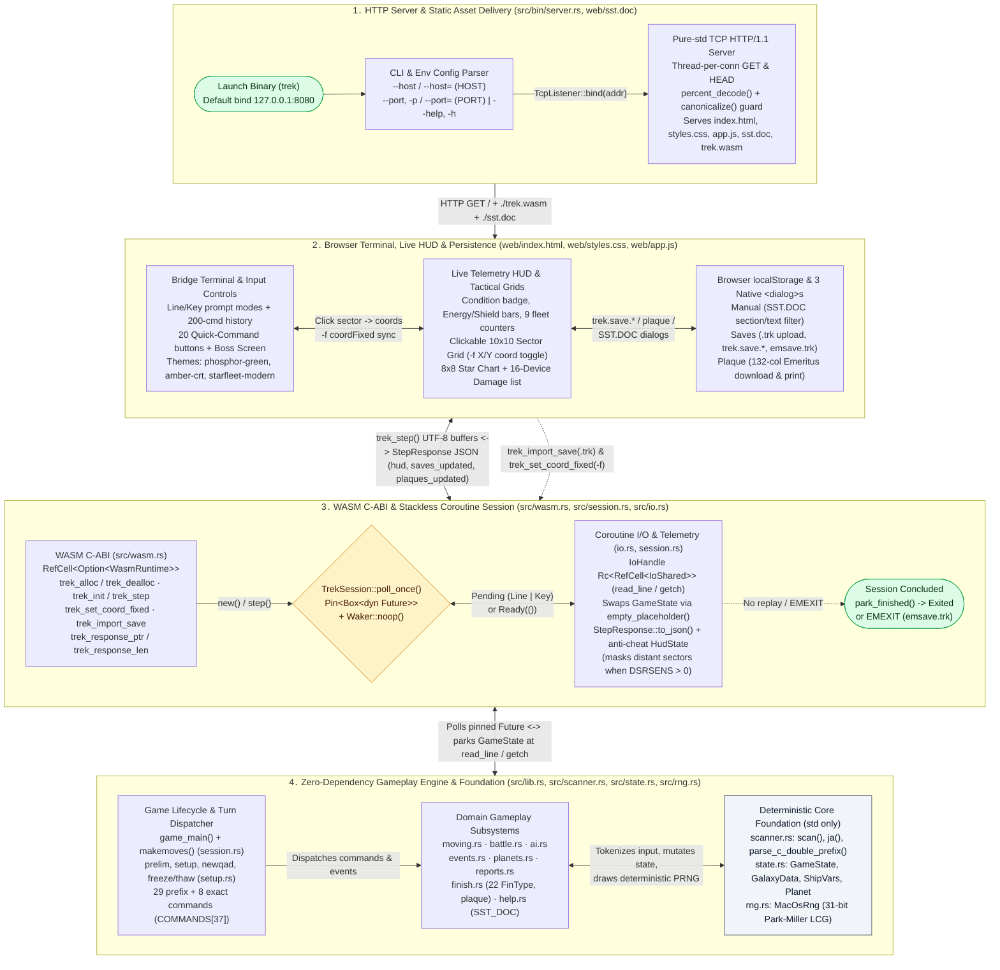
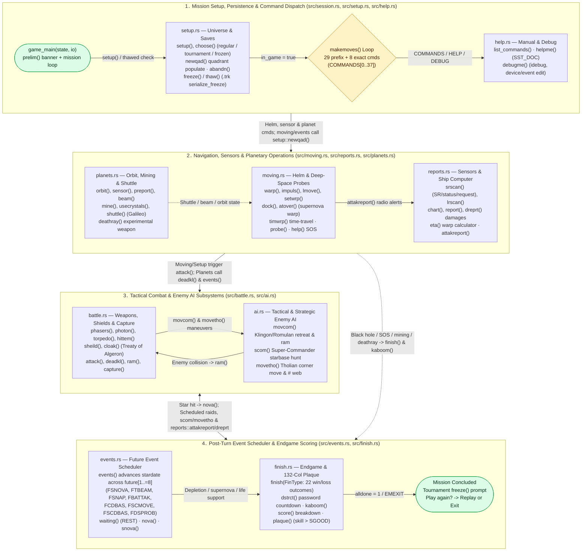
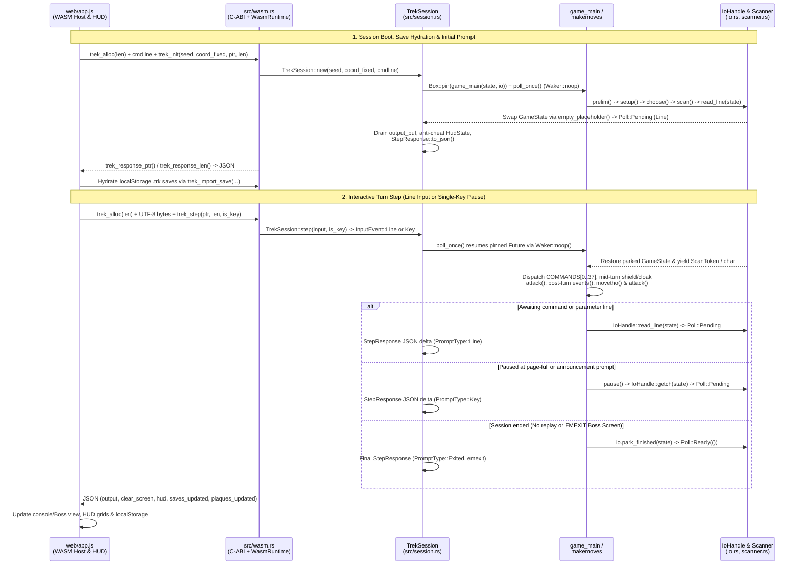
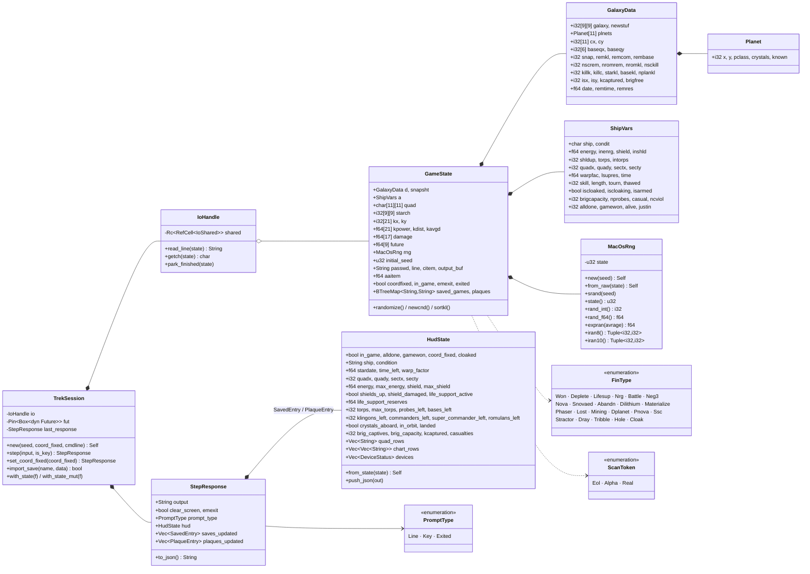
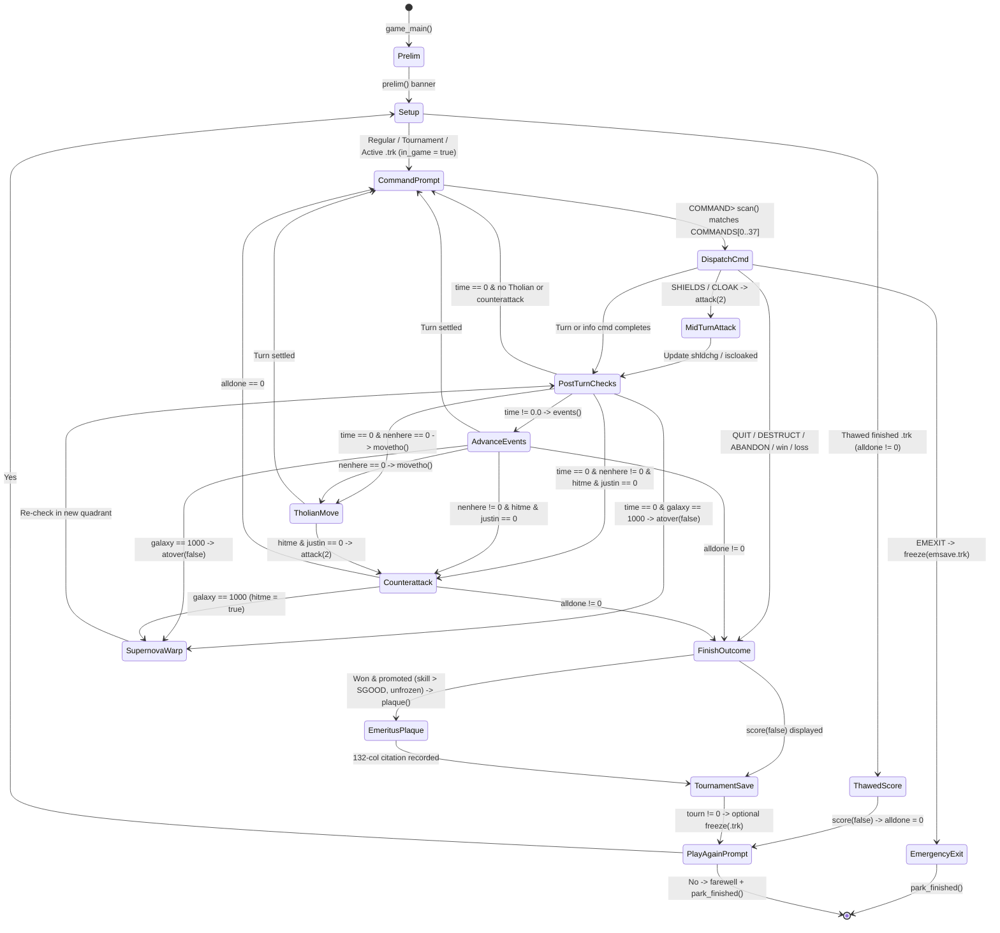

# Trek Architecture Diagrams

End-to-end program flow, gameplay subsystem dispatch, stackless coroutine lifecycle, core data model, and turn-execution state machine for **Trek** — the zero-dependency Rust + WebAssembly port of Tom Almy's *Super Star Trek for Mac OS* ([`Cargo.toml`](../Cargo.toml), [`c_src/`](../c_src/)).

- Standalone Mermaid source (Diagram 1): [`architecture.mmd`](./architecture.mmd)
- Vector landscape PDF export (all 5 diagrams): [`architecture.pdf`](./architecture.pdf)

---

## 1. System & Program Flow Architecture

Traces execution from the pure-`std` HTTP server ([`src/bin/server.rs`](../src/bin/server.rs)) through the browser Bridge Computer and Live Telemetry HUD ([`web/index.html`](../web/index.html), [`web/styles.css`](../web/styles.css), [`web/app.js`](../web/app.js)), across the WebAssembly C-ABI boundary ([`src/wasm.rs`](../src/wasm.rs)) and single-turn `Future` poller ([`src/session.rs`](../src/session.rs), [`src/io.rs`](../src/io.rs)), into the deterministic gameplay engine ([`src/lib.rs`](../src/lib.rs), [`src/scanner.rs`](../src/scanner.rs), [`src/state.rs`](../src/state.rs), [`src/rng.rs`](../src/rng.rs)).

---

## 2. Gameplay Engine Subsystems & Turn Dispatch

Groups the 10 gameplay domain modules in [`src/`](../src/) into four functional stages, showing `makemoves()` command dispatch, cross-module combat/navigation/planet interactions, scheduled stardate events (including subspace radio `attakreport()`), and endgame scoring/plaque paths.

---

## 3. Interactive Step & Coroutine Lifecycle

Illustrates how the prompt-driven C control flow runs in single-threaded WebAssembly without OS threads or manual state-machine rewrites: [`TrekSession`](../src/session.rs) polls a pinned `Future` with `Waker::noop()` until [`IoHandle::read_line`](../src/io.rs) (`ReadLineFuture`) or [`IoHandle::getch`](../src/io.rs) (`GetChFuture`) swaps `GameState` out via `empty_placeholder()` and yields `Poll::Pending`.

---

## 4. Core Data Model

Details the structs and enums across [`src/session.rs`](../src/session.rs), [`src/io.rs`](../src/io.rs), [`src/state.rs`](../src/state.rs), [`src/scanner.rs`](../src/scanner.rs), and [`src/rng.rs`](../src/rng.rs), including 1-based C-faithful galaxy/sector arrays, virtual save/plaque maps, anti-cheat HUD telemetry, and all 22 `FinType` endgame outcomes.

---

## 5. Game Loop & Turn Execution State Machine

Captures the full control flow across `game_main()`, `setup()`, `makemoves()`, and `finish()`, including thawed score-only `.trk` inspection (`alldone != 0`), mid-command free enemy attacks during `SHIELDS`/`CLOAK`, supernova emergency displacement (`atover`), Commodore Emeritus citation eligibility (`skill > SGOOD` when unfrozen), and tournament `.trk` score recording.

---

## 6. Module & Asset Summary

| Path | Role |
| --- | --- |
| [`Cargo.toml`](../Cargo.toml) | Zero-dependency Rust 2021 manifest defining `trek` (`cdylib` + `rlib`) and the `trek` HTTP server binary |
| [`Makefile`](../Makefile) / [`Dockerfile`](../Dockerfile) | Build, WASM compilation ([`scripts/build_web.sh`](../scripts/build_web.sh)), server launch, test, check, and multi-stage container targets |
| [`src/lib.rs`](../src/lib.rs) | Library crate root re-exporting public modules, constants, `.trk` helpers, and the `TrekSession` API |
| [`src/bin/server.rs`](../src/bin/server.rs) | Pure-`std` multi-threaded TCP HTTP/1.1 server serving `./web` on `--host`/`HOST` and `--port`/`PORT` (`127.0.0.1:8080` default) |
| [`src/wasm.rs`](../src/wasm.rs) | `cdylib` C-ABI exports (`trek_alloc`, `trek_dealloc`, `trek_init`, `trek_step`, `trek_set_coord_fixed`, `trek_import_save`, `trek_response_ptr`, `trek_response_len`) |
| [`src/session.rs`](../src/session.rs) | `game_main`, `makemoves`, `TrekSession` single-turn `Future` poller (`Waker::noop`), `StepResponse`, and anti-cheat `HudState` serializer |
| [`src/io.rs`](../src/io.rs) | Coroutine suspension bridge (`IoHandle`, `PromptType`, `InputEvent`, `read_line`, `getch`, `park_finished`) and paging/output helpers (`prout`, `pause`, `skip`) |
| [`src/scanner.rs`](../src/scanner.rs) | C-compatible input tokenizer (`scan`, `ja`, `parse_c_double_prefix`, `ScanToken`) matching `osx.c` / `sst.c` `scan()` |
| [`src/state.rs`](../src/state.rs) | Core state (`GameState`, `GalaxyData`, `ShipVars`, `Planet`, 22-variant `FinType`), 16 device & 9 future-event constants, and JSON helpers |
| [`src/rng.rs`](../src/rng.rs) | Deterministic 31-bit Darwin/macOS Park–Miller LCG (`MacOsRng`: `srand`, `rand_int`, `rand_f64`, `expran`, `iran8`, `iran10`) |
| [`src/setup.rs`](../src/setup.rs) | Mission initialization (`prelim`, `setup`, `choose`), quadrant generation (`newqad`), `abandn`, and `.trk` `freeze`/`thaw` serialization |
| [`src/reports.rs`](../src/reports.rs) | `srscan`, `lrscan`, `chart`, `report`, `dreprt`, `eta`, and subspace radio `attakreport` |
| [`src/moving.rs`](../src/moving.rs) | `warp`, `impuls`, `lmove`, `dock`, `setwrp`, emergency `atover`, `timwrp`, deep-space `probe`, and Starbase `help` (SOS) |
| [`src/battle.rs`](../src/battle.rs) | `phasers`, `photon`, `torpedo`, `hittem`, `sheild`, `cloak` (Treaty of Algeron), `capture`, `attack`, `deadkl`, and `ram` |
| [`src/events.rs`](../src/events.rs) | Scheduled stardate progression (`events` over `future[1..=8]`), `waiting` (`REST`), stellar `nova`, and quadrant `snova` |
| [`src/ai.rs`](../src/ai.rs) | Klingon/Romulan Commander (`movcom`), Super-Commander (`scom`), and Tholian (`movetho` + `#` web) AI |
| [`src/planets.rs`](../src/planets.rs) | Planetary `orbit`, `sensor`, `preport`, `beam` transporter, dilithium `mine`, `usecrystals`, Galileo `shuttle`, and experimental `deathray` |
| [`src/finish.rs`](../src/finish.rs) | Endgame `finish`, `score` breakdown, 132-column Commodore Emeritus `plaque`, self-destruct `dstrct`, and `kaboom` |
| [`src/help.rs`](../src/help.rs) | 37-entry `COMMANDS` table, `list_commands`, `helpme` ([`assets/sst.doc`](../assets/sst.doc) lookup), and `debugme` |
| [`web/`](../web/) | Interactive Bridge Terminal & Live Telemetry HUD ([`index.html`](../web/index.html), [`styles.css`](../web/styles.css), [`app.js`](../web/app.js)), [`sst.doc`](../web/sst.doc), and `trek.wasm` |
| [`tests/`](../tests/) / [`c_src/`](../c_src/) | 7 integration & regression test suites verifying RNG, scanner, navigation, combat, AI, planets, and parity with original ANSI C sources |
