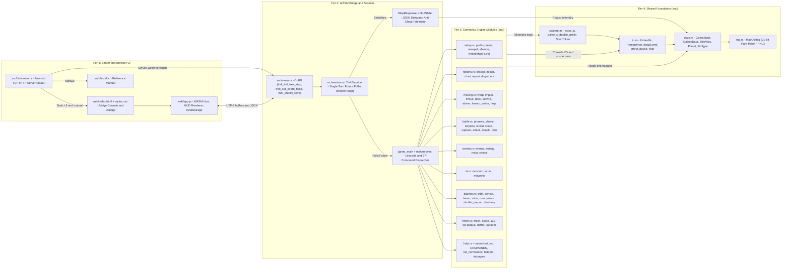
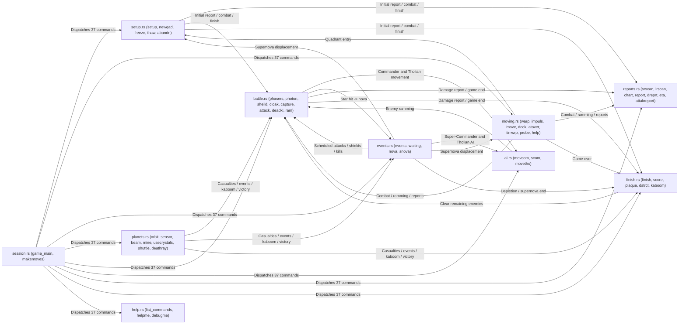
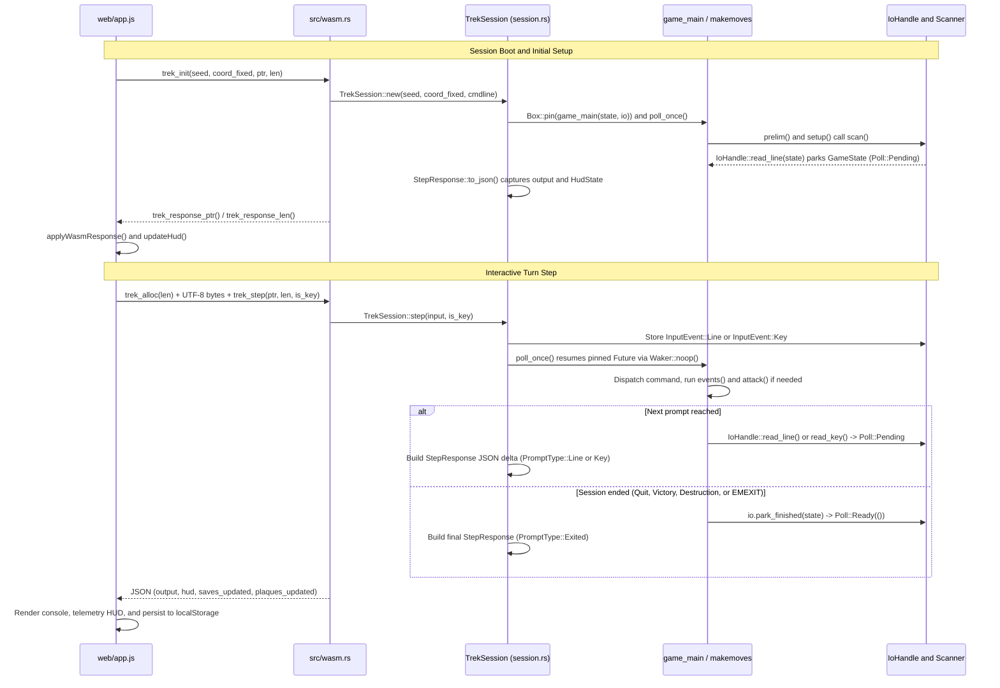
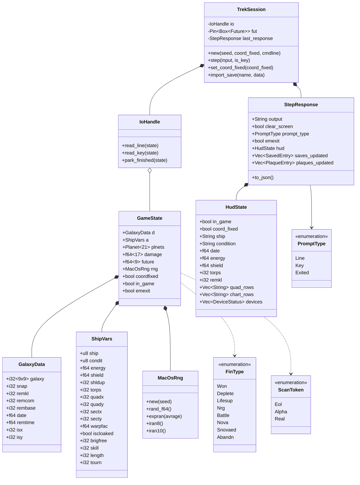
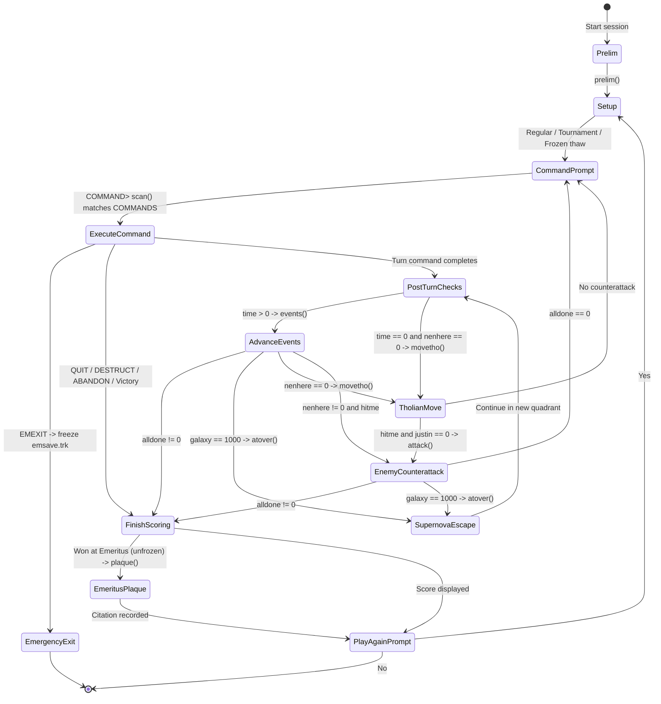

# Trek Architecture Diagrams

This document provides visual architecture, inter-module call graph, execution lifecycle, data model, and state-machine diagrams for the **Trek** (Rust + WebAssembly) port of *Super Star Trek for Mac OS*.

- Standalone Mermaid source: [architecture.mmd](file:///Users/nbrand/projects/trek/docs/architecture.mmd)
- Vector PDF export: [architecture.pdf](file:///Users/nbrand/projects/trek/docs/architecture.pdf)

---

## 1. System & Layer Architecture

Shows the static HTTP server ([src/bin/server.rs](file:///Users/nbrand/projects/trek/src/bin/server.rs)), browser terminal/HUD ([web/](file:///Users/nbrand/projects/trek/web)), WebAssembly C-ABI boundary ([src/wasm.rs](file:///Users/nbrand/projects/trek/src/wasm.rs)), `async`/`await` step driver ([src/session.rs](file:///Users/nbrand/projects/trek/src/session.rs)), domain gameplay modules, and shared state/I/O/RNG foundation.

---

## 2. Gameplay Engine Inter-Module Call Graph

Maps cross-module call relationships across the domain modules inside [src/](file:///Users/nbrand/projects/trek/src).

---

## 3. Interactive Step & Coroutine Lifecycle

Illustrates how the blocking prompt-driven C control flow runs in single-threaded WASM without threads by polling a pinned `Future` until the next `IoHandle` read yields `Poll::Pending`.

---

## 4. Core Data Model

Shows the primary structs and enums shared between the coroutine host, HUD telemetry serializer, gameplay state, and Park–Miller PRNG.

---

## 5. Game Loop & Turn Execution State Machine

Depicts mission setup, the 37-command loop in `makemoves()`, post-turn event and AI resolution, and endgame scoring/plaque transitions.

---

## 6. Module Summary

| Path | Role |
| --- | --- |
| [src/lib.rs](file:///Users/nbrand/projects/trek/src/lib.rs) | Library crate root re-exporting public modules, types, and `TrekSession` API |
| [src/state.rs](file:///Users/nbrand/projects/trek/src/state.rs) | Core game state (`GameState`, `GalaxyData`, `ShipVars`, `Planet`, `FinType`), constants, and JSON helpers |
| [src/rng.rs](file:///Users/nbrand/projects/trek/src/rng.rs) | Deterministic 31-bit Park–Miller PRNG (`MacOsRng`) matching `osx.c` `Rand()` |
| [src/io.rs](file:///Users/nbrand/projects/trek/src/io.rs) | Coroutine I/O suspension (`IoHandle`, `PromptType`, `InputEvent`) and console formatting (`prout`, `pause`, `skip`) |
| [src/scanner.rs](file:///Users/nbrand/projects/trek/src/scanner.rs) | Command/numeric tokenizer (`scan`, `ja`, `parse_c_double_prefix`, `ScanToken`) matching C `scan()` |
| [src/session.rs](file:///Users/nbrand/projects/trek/src/session.rs) | `game_main`, `makemoves`, `TrekSession`, `StepResponse`, and anti-cheat `HudState` snapshot builder |
| [src/wasm.rs](file:///Users/nbrand/projects/trek/src/wasm.rs) | `cdylib` C-ABI exports (`trek_init`, `trek_step`, `trek_set_coord_fixed`, `trek_import_save`, memory allocators) |
| [src/setup.rs](file:///Users/nbrand/projects/trek/src/setup.rs) | Galaxy initialization, quadrant generation (`newqad`), `abandn`, and `.trk` freeze/thaw serialization |
| [src/reports.rs](file:///Users/nbrand/projects/trek/src/reports.rs) | `srscan`, `lrscan`, `chart`, `report`, `dreprt`, `eta`, and starbase attack reports |
| [src/moving.rs](file:///Users/nbrand/projects/trek/src/moving.rs) | `warp`, `impuls`, `lmove`, `dock`, `setwrp`, `atover`, `timwrp`, `probe`, and `help` (SOS call) |
| [src/battle.rs](file:///Users/nbrand/projects/trek/src/battle.rs) | `phasers`, `photon`, `torpedo`, `sheild`, `cloak`, `capture`, `attack`, `deadkl`, and `ram` |
| [src/events.rs](file:///Users/nbrand/projects/trek/src/events.rs) | Future event scheduler (`events`), `waiting` (`REST`), `nova`, and `snova` |
| [src/ai.rs](file:///Users/nbrand/projects/trek/src/ai.rs) | Klingon Commander (`movcom`), Super-Commander (`scom`), and Tholian (`movetho`) AI |
| [src/planets.rs](file:///Users/nbrand/projects/trek/src/planets.rs) | Planetary `orbit`, `sensor`, `beam`, `mine`, `usecrystals`, `shuttle`, `preport`, and `deathray` |
| [src/finish.rs](file:///Users/nbrand/projects/trek/src/finish.rs) | Endgame `finish`, `score`, 132-column Commodore Emeritus `plaque`, `dstrct`, and `kaboom` |
| [src/help.rs](file:///Users/nbrand/projects/trek/src/help.rs) | `COMMANDS` table, `list_commands`, `helpme` (`assets/sst.doc` lookup), and `debugme` |
| [src/bin/server.rs](file:///Users/nbrand/projects/trek/src/bin/server.rs) | Pure-`std` TCP HTTP server serving `./web` on `127.0.0.1:8080` (configurable via `--port` or `PORT`) |
| [web/](file:///Users/nbrand/projects/trek/web) | Interactive terminal UI (`index.html`, `styles.css`, `app.js`), `sst.doc`, and compiled `trek.wasm` |
